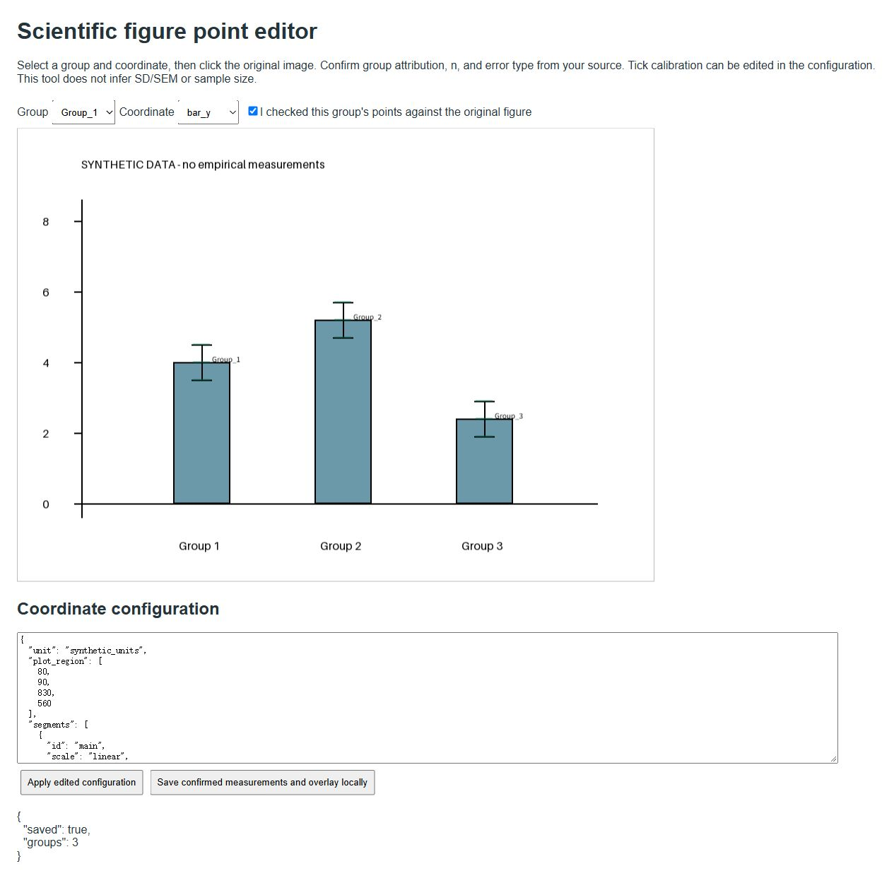

# Synthetic example gallery

Every number, label and diagram here is invented. These are software demonstrations, not research results. The working examples recreate vector PDF/SVG and 600-DPI PNG files under outputs/. Preview images below are smaller renders for documentation.

## digitizer-overlay

## forest

## sensitivity

## loo

## rob-summary

## rob-matrix

## evidence

## prisma

## comparison

## Local point editor

